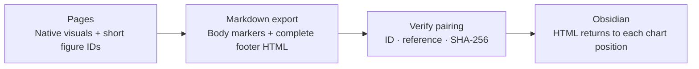

<p align="center">
  
</p>

<h1 align="center">GPT Pages Importer for Obsidian</h1>

<p align="center"><strong>English</strong> · <a href="README.zh-TW.md">繁體中文</a></p>

<p align="center">
  Bring your Pages charts and interactions into Obsidian.<br>
  Complete HTML · Verified pairing · Automatic cleanup · Backup protection
</p>

<p align="center">
  <a href="https://github.com/DLeungDL/obsidian-gpt-pages-importer/actions/workflows/check.yml"></a>
  <a href="manifest.json"></a>
  <a href="docs/format.md"></a>
  <a href="LICENSE"></a>
  <a href="#development"></a>
</p>

<p align="center">
  <a href="#quick-start">Quick start</a> ·
  <a href="#import-or-automatic-cleanup">Workflows</a> ·
  <a href="#rendering-and-trust">Rendering and trust</a> ·
  <a href="skills/gpt-pages-obsidian-visualizations/SKILL.md">Page authoring skill</a>
</p>

---

Keep your ideas in Pages and bring their visualizations into Obsidian. GPT Pages Importer connects exported Markdown with complete, portable HTML sources: it verifies figure pairings, moves footer sources back to their chart positions, and removes verified markers and native image references.

> **Current release: 0.1.1 MVP.** Available in the [Obsidian Community directory](https://community.obsidian.md/plugins/gpt-pages-importer) and through manual installation. See the [compatibility record](docs/compatibility.md) (Traditional Chinese) for the actual scope of device testing. Interactive HTML requires the optional Polyglot Renderer and explicit user trust. The plugin's current interface is in Traditional Chinese; original command labels are included below.

## Why use it?

| | Features |
| :--- | :--- |
| **Portable visuals** | Preserve complete HTML, CSS, JavaScript and data so interactive charts have portable source code. |
| **Compact pairing** | v3 uses short IDs in the body and keeps references and SHA-256 in the footer. Verified HTML returns to its chart position. |
| **Folder cleanup** | Watch one folder and all its subfolders. Add multiple Markdown exports for automatic cleanup in place. |
| **Protected writes** | Preview as plain text, back up before changes, skip identical imports and stop when local edits conflict. |
| **Explicit trust** | Manual imports default to `html-source`. Executable `html` requires explicit confirmation. |
| **Authoring skill** | Includes a Page template, a self-contained interactive example, marker generators and an export-source verifier. |

<a id="quick-start"></a>

## Quick start

### 1 · Install the plugin

Open the [Obsidian Community listing](https://community.obsidian.md/plugins/gpt-pages-importer), select **Add to Obsidian**, and install and enable **GPT Pages Importer** in Obsidian.

For manual installation, download and extract `gpt-pages-importer-0.1.1.zip` from [GitHub Releases](https://github.com/DLeungDL/obsidian-gpt-pages-importer/releases/latest). Copy the extracted `gpt-pages-importer/` folder into:

```text
your vault/
└── .obsidian/
    └── plugins/
        └── gpt-pages-importer/
            ├── main.js
            ├── manifest.json
            ├── styles.css
            └── …license and third-party notices
```

You can also download `main.js`, `manifest.json` and `styles.css` individually into the same plugin folder. Enable the plugin under **Settings → Community plugins**. Reload it after replacing files for a manual update.

<details>
<summary>Build from source</summary>

Requires **Node.js 24** and npm:

```sh
git clone https://github.com/DLeungDL/obsidian-gpt-pages-importer.git
cd obsidian-gpt-pages-importer
npm ci
npm run check
```

Copy `dist/gpt-pages-importer/` into your vault's `.obsidian/plugins/` directory. You can also download the `gpt-pages-importer` build artifact from a successful [GitHub Actions run](https://github.com/DLeungDL/obsidian-gpt-pages-importer/actions/workflows/check.yml).

</details>

### 2 · Prepare a Page export

Download Markdown from Pages with each visualization's complete HTML source included in the document. The bundled [Page authoring skill](skills/gpt-pages-obsidian-visualizations/SKILL.md) helps create compatible Pages. A native image reference alone does not contain the HTML source.

### 3 · Import your first note

1. Run **GPT Pages Importer: **Import Pages Markdown**, then select or drop a file.
2. Review the destination, verified figure count and warnings in the text-only preview.
3. Confirm the import. The destination note opens automatically.

When importing the same Page again, reuse its source name. The default destination for a new source is `GPT Pages/`; later imports reuse the saved destination. See the [detailed usage guide](docs/usage.md) (Traditional Chinese) for other entry points, re-imports and recovery.

## Import or automatic cleanup

| | Manual import | Automatic folder cleanup |
| :--- | :--- | :--- |
| **Best for** | Previewing before creating or updating a destination note | Dropping a batch of exports into a watched folder |
| **Location** | Creates a destination under `GPT Pages/` by default | Modifies the original file, preserving its path and name |
| **Repeat processing** | Skips identical content and stops on conflicting local edits | Skips unchanged content without creating another backup |
| **HTML fences** | Defaults to `html-source`; trusted imports can use `html` | Preserves existing fence languages by default; folder rendering trust is optional |
| **Backups** | Before replacing an existing destination | Before each modification in place |

In the plugin settings, enter an existing vault folder under **自動清理資料夾** ("Automatic cleanup folder"). Turn on **啟用自動清理** ("Enable automatic cleanup") and select **儲存設定** ("Save settings"). Saving and enabling scans existing Markdown and then handles files added, modified or moved into the folder or any subfolder.

Cleanup removes only verified figure markers and native image references. A verified footer source moves to its original figure position. Backups and destination notes tracked by the manual importer are excluded. Cleanup backups are stored under `GPT Pages Backups/cleanup`. See the [settings and trust guide](docs/usage.md#指定資料夾自動清理) (Traditional Chinese) for details.

## From Page to note



The importer reads HTML from the exported Markdown. It removes a figure's marker and native image reference only when its unique ID, exact reference, complete source and SHA-256 all verify. Ambiguous pairings stay unchanged and produce warnings. Older v1 and v2 formats remain supported.

[Read the pairing contract →](docs/format.md) (Traditional Chinese) · [English authoring format reference →](skills/gpt-pages-obsidian-visualizations/references/export-format.md)

## Rendering and trust

Manual imports keep HTML in `html-source` fences by default. For interactive rendering, inspect the source, explicitly trust it, and use the separately installed [Polyglot Renderer](https://github.com/Nimaapr/polyglot-renderer) to render `html` fences.

- Manual import trust covers **all HTML blocks in the document**.
- Folder trust covers **all current and future HTML blocks in the folder and its subfolders**, including unpaired blocks.
- Automatic cleanup preserves existing fence languages by default. Disabling rendering stops future conversions; it does not revert existing `html` blocks.
- Changes are backed up before writing. Trusted JavaScript may execute and make network requests. A matching SHA-256 establishes source consistency, not code safety.

To enable rendering after cleanup, turn on **清理後啟用 HTML 渲染** ("Enable HTML rendering after cleanup"), read and confirm the folder trust dialog, then save settings. Changing the watched folder requires confirming trust again. The importer does not install or enable a renderer automatically.

[Rendering options, backups and recovery →](docs/usage.md) (Traditional Chinese)

## Privacy and access

The plugin is free, requires no account, payment or API key, collects no telemetry and sends no network requests. Manual import reads the external Markdown file you select through the file picker. Writes stay within the current vault: destination notes, backups and plugin settings. Automatic cleanup processes only the configured vault folder and its subfolders.

HTML rendering is provided by the separately installed Polyglot Renderer. If trusted HTML or JavaScript includes external images, fonts, libraries or requests, the renderer may contact those services. Inspect the complete source before enabling trust.

The importer does not download Page assets or provide cloud or bidirectional sync.

## Documentation and resources

| Task | Resource |
| :--- | :--- |
| Installation, importing, watched folders, re-imports and recovery | [Detailed usage guide](docs/usage.md) (Traditional Chinese) |
| v3, v2 and v1 pairing rules | [Format contract](docs/format.md) (Traditional Chinese) |
| Author portable Pages for Obsidian | [English skill and tools](skills/gpt-pages-obsidian-visualizations/SKILL.md) · [English format reference](skills/gpt-pages-obsidian-visualizations/references/export-format.md) |
| Check validation scope | [Compatibility record](docs/compatibility.md) · [Round-trip evidence summary](docs/pages-roundtrip.md) (Traditional Chinese) |
| Try authored sample data | [Static example](examples/static.md) · [Interactive example](examples/interactive.md) (Traditional Chinese) |
| Report a bug or request a feature | [GitHub Issues](https://github.com/DLeungDL/obsidian-gpt-pages-importer/issues) |

<a id="development"></a>

## Development

```sh
npm run typecheck   # Strict TypeScript
npm run build       # Bundle, package and smoke-test loading
npm test            # Vitest regression tests
npm run check       # Public-data check + build + tests
```

The skill's Python verifier also has standard-library tests:

```sh
python -B -m unittest discover -s tests -p 'test_skill_export.py' -v
```

Conversion logic lives in [src/convert.ts](src/convert.ts), importing and conflict protection in [src/importer.ts](src/importer.ts), and automatic cleanup in [src/cleanup.ts](src/cleanup.ts). Public fixtures use fictional identifiers. Private Pages, original exports and screenshots stay outside Git.

<details>
<summary><strong>FAQ</strong></summary>

### Why do I only have native image references, without portable interactive charts?

A `visualize:` reference does not contain complete HTML. Use the [authoring skill](skills/gpt-pages-obsidian-visualizations/SKILL.md) to include matching sources in the Page footer before exporting Markdown.

### Can I process multiple documents at once?

Place multiple Markdown files into the watched folder or its subfolders for automatic cleanup. The manual import dialog accepts one file at a time.

### Does the plugin download from Pages or sync automatically?

Import and cleanup use Markdown you provide. They do not connect to Pages to download attachments or offer cloud or bidirectional sync.

</details>

## License

This project uses the [MIT License](LICENSE), covering the plugin source, documentation and bundled Page authoring skill. Bundled dependencies retain their own licenses. Complete third-party notices are included with release assets and embedded in `main.js`.
