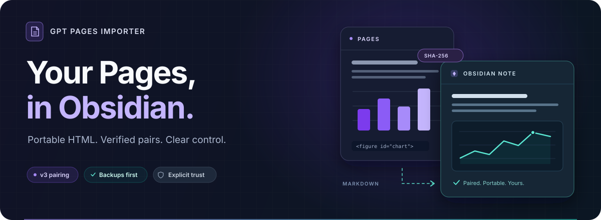
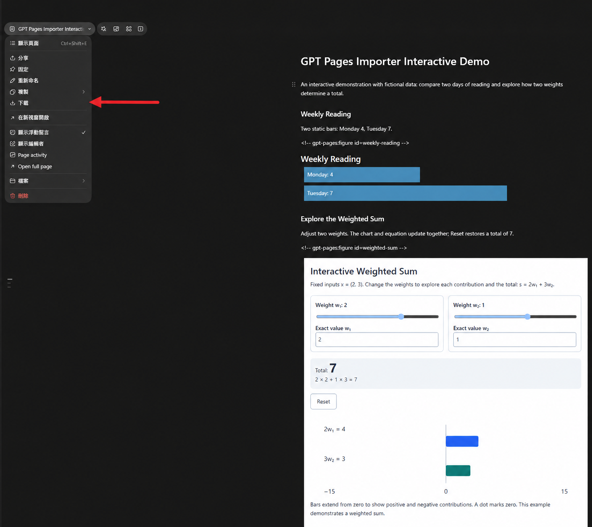
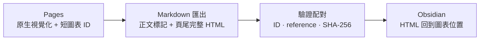

<p align="center">
  
</p>

<h1 align="center">GPT Pages Importer for Obsidian</h1>

<p align="center"><a href="README.md">English</a> · <strong>繁體中文</strong></p>

<p align="center">
  把 Pages 的圖表與互動，帶進你的 Obsidian 筆記。<br>
  完整 HTML・精準配對・自動清理・備份保護
</p>

<p align="center">
  <a href="https://github.com/DLeungDL/obsidian-gpt-pages-importer/actions/workflows/check.yml"></a>
  <a href="manifest.json"></a>
  <a href="docs/format.zh-TW.md"></a>
  <a href="LICENSE"></a>
  <a href="#development"></a>
</p>

<p align="center">
  <a href="#quick-start">快速開始</a> ·
  <a href="docs/usage.zh-TW.md">使用指南</a> ·
  <a href="docs/format.zh-TW.md">配對格式</a> ·
  <a href="skills/gpt-pages-obsidian-visualizations/SKILL.md">Page 生成技能</a>
</p>

---

Pages 負責呈現想法，Obsidian 負責收藏與延伸。這個外掛把匯出的 Markdown 與完整、可攜的 HTML 原始碼（portable HTML source）接起來：驗證圖表配對，將頁尾來源移回圖表位置，清除已確認的標記與原生圖片參照。

> **目前版本為 0.1.6 MVP。** 已上架 [Obsidian 社群目錄（Community directory）](https://community.obsidian.md/plugins/gpt-pages-importer)，亦可手動安裝；已完成的桌面驗證與其他平台的實測範圍，見[相容性紀錄](docs/compatibility.zh-TW.md)。互動 HTML 需選用的 Polyglot Renderer，並由使用者明確確認信任。

## 為什麼使用它？

0.1.5 提供中英文介面：跟隨 Obsidian 語言，繁體中文使用 `zh-TW`，英文及未支援語言使用英文。切換 Obsidian 語言並依提示重新載入後套用；舊版語言讀取保留相容處理。

| | 能帶走的內容與工作流程 |
| :--- | :--- |
| **圖表保留（Portable visuals）** | 保存完整 HTML、CSS、JavaScript 與資料，讓互動圖有可攜的原始碼。 |
| **精簡配對（Compact pairing）** | v3 正文只留短 ID，參照與 SHA-256 集中頁尾；驗證後把 HTML 移回各圖位置。 |
| **資料夾清理（Folder cleanup）** | 監看指定資料夾及所有子資料夾，可一次放入多個 Markdown，自動原地處理。 |
| **寫入保護（Protected writes）** | 純文字預覽、修改前備份、重複匯入不重寫，本機修改有衝突保護。 |
| **明確信任（Explicit trust）** | 手動匯入預設保存為 `html-source`；經確認後才產生供 renderer 執行的 `html`。 |
| **AI 生成流程（AI authoring workflow）** | 匯入前先使用附帶技能，製作含配對 HTML 來源的 Page；提供版型、標記生成器與匯出原碼驗證工具。 |

<a id="quick-start"></a>

## 快速開始（Quick start）

### 1 · 在 AI 代理中使用生成技能

**前置需求（prerequisite）：在 AI 代理（AI agent）中啟用並連接 [Pages 外掛](https://chatgpt.com/plugins/plugin_connector_1p_4a72ddeef4c481918f92d8e8df18fb2c?open_in_app)，再選取 `@Pages`。** 代理必須能使用 Pages 的讀寫及原生視覺化工具。此技能要求建立或更新 Page 時使用 Pages 工具；若工具不可用或無法存取目標 Page，請先完成連接或取得存取權，再繼續操作。

將完整的 [`skills/gpt-pages-obsidian-visualizations/`](skills/gpt-pages-obsidian-visualizations/) 資料夾加入代理的技能庫，包含 scripts、references 與 assets。如果代理透過檔案讀取指引，請指定其中的 [SKILL.md](skills/gpt-pages-obsidian-visualizations/SKILL.md)，並保留其連結的資源供代理使用。匯出前，先搭配 Pages 使用技能準備 Page。

可直接使用以下提示詞（prompt）：

```text
使用 @Pages 與 $gpt-pages-obsidian-visualizations，建立或更新一個以［你的主題］為內容、可匯出 Markdown 至 Obsidian 的 GPT Page。請透過 Pages 工具寫入 Page 並建立原生視覺化。正文保留原生視覺化與只含短 ID 的 v3 精簡標記，頁尾集中放置每張圖對應的完整、自包含 HTML 原始碼、原生參照與 SHA-256；不得回退 v2。
```

技能會準備原生圖表、簡短圖表 ID，以及含對應參照（reference）與 SHA-256 校驗資訊的頁尾 HTML。這是本流程必要的製作步驟：一般 Page 匯出可能只有原生圖片參照，未包含可攜式 HTML，外掛無法還原缺少的來源。技能在 AI 代理中使用，GPT Pages Importer 則在 Obsidian 中處理產生的 Markdown。

0.1.6 起，技能與生成工具強制使用 v3，即使未知目標外掛版本也不回退；匯入器仍相容既有 v1／v2 匯出檔。一般 Page 保留 `html` 來源圍欄（code fence）；自動清理的信任流程測試另用 `html-source` Markdown 副本，HTML 位元組（bytes）與校驗值保持相同。確認資料夾信任後，按「儲存設定」（Save settings）才套用轉換。AI 代理中的技能資料夾需與 Obsidian 外掛分別更新。

### 2 · 取得外掛

開啟 [Obsidian 社群外掛頁面](https://community.obsidian.md/plugins/gpt-pages-importer)，按 **Add to Obsidian**，在 Obsidian 內安裝並啟用 **GPT Pages Importer**。

如需手動安裝：

從 [GitHub Releases](https://github.com/DLeungDL/obsidian-gpt-pages-importer/releases/latest) 下載 `main.js`、`manifest.json` 與 `styles.css`，放入同一個 `gpt-pages-importer/` 資料夾。授權及第三方聲明已嵌入 `main.js`。

<details>
<summary>自行建置（Build from source）</summary>

需要 **Node.js 24** 與 npm：

```sh
git clone https://github.com/DLeungDL/obsidian-gpt-pages-importer.git
cd obsidian-gpt-pages-importer
npm ci
npm run check
```

也可在成功的 [GitHub Actions 工作流程](https://github.com/DLeungDL/obsidian-gpt-pages-importer/actions/workflows/check.yml) 下載 `gpt-pages-importer` 建置產物（artifact）。

</details>

### 3 · 安裝到 Obsidian

將包含三個下載檔的 `gpt-pages-importer/`（自行建置則為 `dist/gpt-pages-importer/`）整個資料夾複製到：

```text
你的 vault/
└── .obsidian/
    └── plugins/
        └── gpt-pages-importer/
            ├── main.js
            ├── manifest.json
            └── styles.css
```

在 **設定 → Community plugins** 啟用 **GPT Pages Importer**。更新檔案後，重新載入外掛。

### 4 · 從 Pages 下載 Markdown

1. 開啟使用技能準備好的 Page，點選左上角的頁面標題選單。
2. 按下圖紅色箭頭指向的 **下載（Download）**，將 Page 儲存為 Markdown（`.md`）檔案。



確認下載的 Markdown 包含圖表標記（markers），且各圖完整的 `html` 程式碼區塊已包含在頁尾。若缺少來源，請讓 AI 代理使用技能補齊 Page，再重新匯出。

### 5 · 匯入第一份筆記

1. 執行 **GPT Pages Importer: 匯入 Pages Markdown**，選取或拖入下載的檔案。
2. 查看目的地、成功配對數與警告，確認後寫入；目的筆記會自動開啟。

後續重匯同一 Page，沿用相同的來源識別名稱（source name）。完整流程與其他入口見[使用指南](docs/usage.zh-TW.md)。

需要使用互動圖表時，請安裝 Polyglot Renderer、檢查 HTML 並明確確認信任，詳見下方「閱讀、渲染與信任」。

## 選擇你的工作方式

| | 手動匯入（Import） | 資料夾自動清理（Automatic cleanup） |
| :--- | :--- | :--- |
| **適合情境** | 預覽後建立或更新目的筆記 | 將一批匯出檔直接放入指定資料夾 |
| **處理位置** | 預設建立於 `GPT Pages/` | 直接修改原檔，保留路徑與檔名 |
| **重複處理** | 內容相同不寫入；本機修改停止覆寫 | 已清理內容不重寫，不新增備份 |
| **HTML 語言** | 預設 `html-source`，信任後可輸出 `html` | 預設保留原語言，可另確認資料夾渲染信任 |
| **備份** | 更新既有目的筆記前備份 | 每次原地修改前備份 |

設定自動清理時，填入一個監看資料夾（watched folder），即可涵蓋所有子資料夾。儲存並啟用後，會掃描既有文件，並處理之後新增、修改與移入的 Markdown。詳見[設定與信任流程](docs/usage.zh-TW.md#指定資料夾自動清理)。

## 從 Page 到筆記



外掛從匯出檔讀取 HTML。只有唯一 ID、精確原生參照（reference）、完整來源與 SHA-256 全部通過，才清除該組標記及圖片參照；配對不明確時保留原文並警告。v1／v2 舊格式仍相容。

[閱讀 v3 配對契約 →](docs/format.zh-TW.md)

## 閱讀、渲染與信任

手動匯入預設將原始碼保留為 `html-source`。需要互動時，先檢查內容、明確信任，再配合獨立安裝的 [Polyglot Renderer](https://github.com/Nimaapr/polyglot-renderer) 呈現 `html`。

匯入視窗與自動清理的 HTML 渲染選項旁，會顯示 Polyglot Renderer「未安裝／未啟用／已啟用」。安裝或變更啟用狀態後，可按「重新檢查 renderer」。偵測讀取目前資料庫（vault）的安裝檔及已儲存啟用清單，不代表已成功載入或 renderer 設定正確；無法讀取或安裝不完整時顯示「無法確認」。狀態偵測不會代替信任確認、自動安裝／啟用外掛，或阻擋匯入與清理。

- 手動匯入的信任適用於**整份文件的 HTML 區塊**。
- 資料夾信任適用於該資料夾及子資料夾中，**現有與日後的所有 HTML 區塊**。
- 自動清理預設保留既有語言；關閉渲染選項不會還原已是 `html` 的區塊。
- 寫入前先備份；JavaScript 可能執行並發出網路請求。SHA-256 配對成功不代表程式碼安全。

[查看渲染選項、備份與還原 →](docs/usage.zh-TW.md)

## 隱私與存取（Privacy and access）

此外掛免費使用，不要求帳號、付款或 API 金鑰，不收集遙測資料（telemetry），也不自行發送網路請求。手動匯入會透過檔案選擇器讀取你選擇的 vault 外 Markdown；寫入僅限目前 vault 內的目的筆記、備份與外掛設定。自動清理只處理你指定的 vault 資料夾及子資料夾。

HTML 渲染由獨立安裝的 Polyglot Renderer 提供；你信任的 HTML／JavaScript 若包含外部圖片、字型、函式庫或請求，可能由 renderer 存取相應遠端服務。請在啟用信任前檢查完整內容。

## 文件與資源

| 想完成的事 | 從這裡開始 |
| :--- | :--- |
| 安裝、匯入、設定監看資料夾、重匯與還原 | [完整使用指南](docs/usage.zh-TW.md) |
| 編寫或檢查 v3／v2／v1 配對格式 | [格式契約](docs/format.zh-TW.md) |
| 生成可匯出至 Obsidian 的 Page | [完整技能與工具](skills/gpt-pages-obsidian-visualizations/SKILL.md) |
| 核對原生圖與 Markdown 匯出的實測範圍 | [相容性紀錄](docs/compatibility.zh-TW.md) · [往返驗證摘要](docs/pages-roundtrip.zh-TW.md) |
| 試讀通用、自行編寫的資料 | [靜態範例](examples/static.zh-TW.md) · [互動範例](examples/interactive.zh-TW.md) |

<a id="development"></a>

## 開發與驗證（Development）

```sh
npm run typecheck   # TypeScript
npm run build       # 打包與載入檢查
npm test            # Vitest 回歸測試
npm run check       # 公開資料檢查 + 建置 + 測試
```

技能的 Python 驗證器另有標準函式庫測試：

```sh
python -B -m unittest discover -s tests -p 'test_skill_export.py' -v
```

轉換邏輯位於 [src/convert.ts](src/convert.ts)，匯入與衝突保護位於 [src/importer.ts](src/importer.ts)，自動清理位於 [src/cleanup.ts](src/cleanup.ts)。公開測試只使用虛構識別碼；私人 Page、原始匯出與截圖保留在 Git 外。

<details>
<summary><strong>常見問題（FAQ）</strong></summary>

### 為什麼只有原生圖片參照，沒有可攜的互動圖？

`visualize:` 參照本身不包含完整 HTML。請使用[生成技能](skills/gpt-pages-obsidian-visualizations/SKILL.md)，在 Page 頁尾加入與原生圖配對的完整來源，再匯出 Markdown。

### 可以一次處理多份文件嗎？

可以把多個 Markdown 放進監看資料夾或其子資料夾，由自動清理處理；手動匯入視窗每次選取一個檔案。

### 會自動連線 Pages 下載或同步嗎？

匯入與清理都使用你提供的 Markdown，不連線 Pages 下載附件，也不提供雲端或雙向同步。

</details>

## 授權（License）

本專案採 [MIT 授權](LICENSE)，包含外掛原始碼、文件與附帶的 Page 生成技能。打包依賴保留各自授權，完整聲明（third-party notices）隨發行檔提供，並嵌入 `main.js`。
